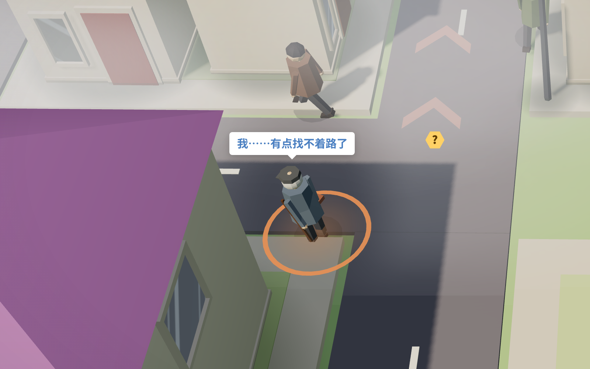
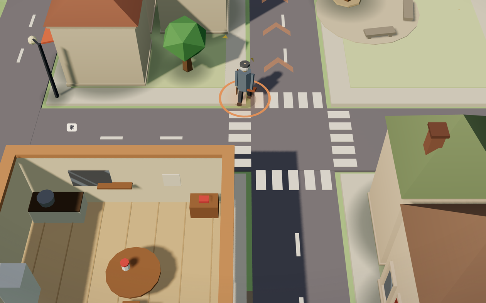

# 爷爷的一周 · A Week with Grandpa

**一款以认知变化为规则的照护策略游戏。** 爷爷老李在小镇住了四十年，近来记性变差，但买菜、下棋、接孙女，他仍想自己来。玩家是他身边的家人：清晨为他布置好认的小镇，白天看着他出门，在他犹豫时决定帮多少。帮少了他会迷路，帮多了他会越来越依赖你，后果都会带到第二天。

*A single-player browser game about caring for a grandfather with early cognitive changes. The fog on the map is his mental map; every bit of help has a cost, and today's choices shape tomorrow.*

▶ **在线试玩 / Play**：<https://zuooonz.github.io/MemoryGarden/>（电脑或手机浏览器直接打开，无需安装；完整一周约 30 分钟）

AIGCC 2026 小红花游戏赛道（适老关怀）参赛作品，入围 32 强。



## 玩法

每天分四步：

1. **清晨布置**：用 3 点精力在小镇和家里放支持物。路标放在起雾的路口，雾就散开；拜托邻居，他路过时有人招呼、指路；还有药盒、便签、大字日历、老照片、老歌、反诈约定，逐日解锁。
2. **白天观察**：他按自己记得的路出门。**雾就是他心里的地图**：雾越浓，他在那个路口走错的可能越大，画面和规则用的是同一个数。家门口、老榕树这些几十年的老地方没有雾；旧貌改变的老地方（老电影院改成了手机店）反而最难认。
3. **关键时刻介入**：他在路口犹豫、打来电话时，可以先问他看到了什么（他认出来，仍算他自己办的），再在电话里指路（一次最多三个路口），最后才去陪他。在家里也一样：先等一等，再提示，最后才直接告诉。
4. **傍晚结算**：看事办成没有、有多少是他自己办的、心情怎样，以及**明天会怎样**：出了意外，家里不放心，明天每趟都要人陪；帮得太多，他明天第一趟就想让你陪；帮得刚好，他明天精神更好。

七天里病程也在推进：当天认出的路口第二天又起雾，熟悉的路口也开始起雾。第六天是完整的反诈章节：冒充女儿的诈骗电话，玩家要听出破绽，劝他自己挂断，再打女儿原来的号码核实。

**认知小关卡**：每天一个，题型改编自阿尔茨海默症筛查量表，嵌在当天的事务里（回忆早餐时念的菜单、找零连续减 7、修摔坏的闹钟、按三步指令包饺子……）。游戏内说明这些属于游戏体验，不做诊断。

**适老设计**：字号三档、提示文字三档、雾可调淡（只改显示、不改难度）、旁白朗读提示；小关卡和犹豫时刻里时钟暂停，没有时间压力；画面按设备性能自动选档。



## 技术

- **Three.js 程序化 3D**：房屋、人物、车辆、树木、老照片全部由代码生成，没有外部图片和模型；音乐、音效在浏览器里实时合成。
- **单个 HTML 文件**：约 9,000 行原生 JavaScript（ES 模块，50 个模块、分 7 层），esbuild 打包成一个可离线运行的 HTML，配音一起内嵌。
- **规则与画面分离**：规则层（`Game/src/sim.js`、`walk.js`、`tasks.js`）不依赖浏览器，可在 Node 里整周模拟；雾的浓淡直接读规则里的走错概率。
- **完整交通与行走**：人车按斑马线互让，行人侧身绕开，人物出现、消失统一淡入淡出。
- **自动检查体系**：`npm run check` 几秒内跑完构建、模块分层、规则结果快照、存档升级、剧情数据一致、210 局情境自检；`npm run verify` 再加 7 天回归、排版、设置组合、穿模与台词、界面像素比对；`npm run stability` 连玩一周记帧率与内存。
- **配音**：约 300 句，本机用开源语音合成模型离线生成，声线按文字描述设计，不克隆任何真人；再用语音识别逐句核对。

## AI 协作开发

本作由作者主导、AI 编程助手完成大部分实现：作者确定主题、研究依据与医学表述边界，做所有取舍并反复试玩；Claude（经 Claude Code）提出机制方案、起草剧情与文案、编写全部代码和自动化测试，Codex 参与了项目早期。详见 [创作过程与 AI 证据](Docs/赛事/创作过程与AI证据.md) 和 [创作过程与 AI 使用说明](Docs/赛事/提交材料/创作过程与AI使用说明.md)。

仓库里的 [AGENTS.md](AGENTS.md) 是写给 AI 助手的协作规则，保留作为这种开发方式的记录。

## 目录

| 位置 | 内容 |
|---|---|
| [Game/](Game/README.md) | 游戏工程：源码 `src/`、检查与测试工具 `tools/` |
| [Docs/项目基线.md](Docs/项目基线.md) | 设计原则与边界 |
| [Docs/游戏系统.md](Docs/游戏系统.md) | 规则与数值（雾、帮法、心情、评价、跨天影响） |
| [Docs/剧情与关卡一览.md](Docs/剧情与关卡一览.md) | 七天剧情、关卡与人物 |
| [Docs/架构.md](Docs/架构.md) | 代码分层、共享状态、检查与规矩 |
| [Docs/界面与交互规范.md](Docs/界面与交互规范.md)、[美术方向](Docs/美术方向.md)、[声音设计](Docs/声音设计.md)、[地基方案](Docs/地基方案.md) | 界面、画面、声音、人车行走的设计 |
| [Docs/研究/](Docs/研究/) | 认知筛查量表研究与关卡引导 |
| [Docs/设计基石.md](Docs/设计基石.md)、[Docs/关卡重设计/](Docs/关卡重设计/README.md) | 下一版（未实现）的设计思考 |
| [Docs/路演演示文稿.pdf](Docs/路演演示文稿.pdf) | 32 强线上路演的演示文稿（15 页） |
| [Logs/状态.md](Logs/状态.md) | 最终状态、已知问题、未完成的方向 |

## 本地运行

```bash
cd Game
npm install
npm run dev      # http://127.0.0.1:5173
npm run build    # 生成单文件 Game/dist/index.html
npm run check    # 快速检查
```

## 许可

源代码采用 [MIT](LICENSE)；剧情、文字、配音与文档采用 [CC BY-NC 4.0](LICENSE-CONTENT.md)。第三方组件见 [THIRD_PARTY.md](THIRD_PARTY.md)。
